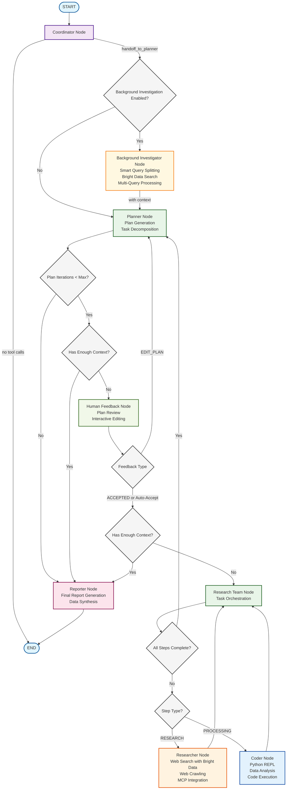
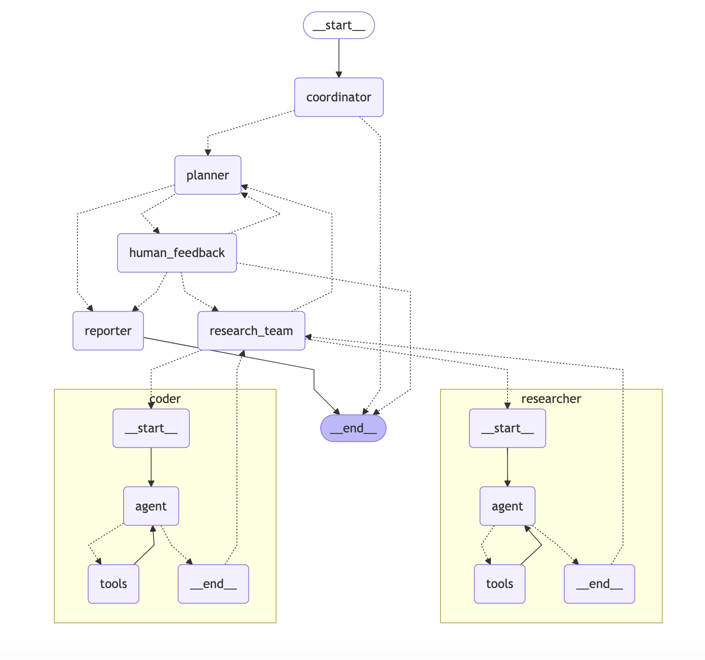

# 🌟 BrightFlow

[](https://www.python.org/downloads/) [](https://opensource.org/licenses/MIT) [](https://github.com/bytedance/deer-flow)

> **演示项目**：一个基于 DeerFlow 构建的原型展示，用于演示 Bright Data 的网页情报能力如何实现研究自动化。

## 🧪 项目状态

**BrightFlow** 是一个**演示项目**和**原型**，展示 Bright Data 网页情报平台与 AI 驱动研究工作流的集成。本项目是一个用于评估和测试的**概念验证**。

**重要说明：**
- 这是一个**演示/原型**，并非可用于生产环境的系统
- 作为 Bright Data 能力与 AI 研究工具集成的**展示项目**而构建
- 基于字节跳动的开源 DeerFlow 框架

## 🙏 致谢

**BrightFlow** 是字节跳动 [DeerFlow](https://github.com/bytedance/deer-flow) 的一个分叉版本。我们感谢 DeerFlow 原团队和字节跳动创建了作为本项目基础的深度研究框架。

> **DeerFlow 原始描述**：深度探索与高效研究流程，一个由社区驱动、基于开源社区杰出成果构建的深度研究框架。

## 演示


https://github.com/user-attachments/assets/5829964f-31a0-419c-9978-10e15223ccba


## 🚀 BrightFlow 有何不同

本**演示项目**基于 DeerFlow 的基础，通过 **Bright Data 的网页情报平台**展示了增强的能力：

### 🔍 **增强的搜索能力**
- **Bright Data 搜索集成**：利用 Bright Data 的高级搜索 API，提供更全面、更准确的结果
- **企业级数据质量**：通过 Bright Data 网络访问更整洁、更可靠的数据源
- **全球覆盖**：增强跨地区和跨语言搜索能力

### 🕷️ **高级网页爬虫**
- **Bright Data 抓取**：集成 Bright Data 强大的爬虫基础设施
- **反机器人保护**：通过 Bright Data 的代理网络访问受保护的内容
- **可扩展的数据采集**：凭借企业级爬虫能力处理大型研究项目

### 🧠 **智能查询处理**
- **智能查询拆分**：自动将复杂用户查询拆分为多个经过优化的子查询的节点
- **并行研究**：同时执行多个研究流程，实现全面覆盖
- **上下文聚合**：合并多个查询的结果，获得更丰富、更完整的洞察

### 🎨 **增强的用户体验**
- **BrightFlow 品牌设计**：全面重塑品牌，改进视觉设计和用户体验
- **更出色的性能**：利用 Bright Data 基础设施优化工作流

## 📑 目录

- [🚀 快速开始](#快速开始)
- [🌟 功能](#功能)
- [🔧 Bright Data 配置](#-bright-data-配置)
- [🏗️ 架构](#架构)
- [🛠️ 开发](#开发)
- [🐳 Docker](#docker)
- [🗣️ 文本转语音集成](#文本转语音集成)
- [❓ 常见问题](#常见问题)
- [📜 许可证](#许可证)
- [💖 致谢](#致谢)

## 快速开始

BrightFlow 使用 Python 开发，并提供采用 Node.js 编写的网页 UI。为确保设置过程顺畅，我们建议使用以下工具：

### 推荐工具

- <strong>[`uv`](https://docs.astral.sh/uv/getting-started/installation/)：</strong>简化 Python 环境和依赖项管理。`uv` 会自动在根目录中创建虚拟环境，并为你安装所有必需的软件包，无需手动安装 Python 环境。

- <strong>[`nvm`](https://github.com/nvm-sh/nvm)：</strong>轻松管理多个版本的 Node.js 运行时。

- <strong>[`pnpm`](https://pnpm.io/installation)：</strong>安装并管理 Node.js 项目的依赖项。

### 环境要求

请确保你的系统满足以下最低要求：

- <strong>[Python](https://www.python.org/downloads/)：</strong>版本 `3.12+`
- <strong>[Node.js](https://nodejs.org/en/download/)：</strong>版本 `22+`

### 安装

```bash
# Clone the repository
git clone https://github.com/bright-cn/bright-flow.git
cd bright-flow

# Install dependencies, uv will take care of the python interpreter and venv creation, and install the required packages
uv sync

# Configure .env with your API keys
# Bright Data: https://brightdata.com/ (Primary search and crawling provider)
# Tavily: https://app.tavily.com/home (Fallback search option)
# Brave Search: https://brave.com/search/api/ (Alternative search option)
# volcengine TTS: Add your TTS credentials if you have them
cp .env.example .env

# Configure conf.yaml for your LLM model and API keys
# Please refer to 'docs/configuration_guide.md' for more details
cp conf.yaml.example conf.yaml

# Install marp for ppt generation
# https://github.com/marp-team/marp-cli?tab=readme-ov-file#use-package-manager
brew install marp-cli
```

你也可以通过 [pnpm](https://pnpm.io/installation) 安装网页 UI 依赖项：

```bash
cd bright-flow/web
pnpm install
```

### 配置

有关更多详情，请参阅[配置指南](docs/configuration_guide.md)。

> [!NOTE]
> 启动项目之前，请仔细阅读本指南，并根据你的具体设置和要求更新配置。请务必配置 Bright Data 凭据，以获得最佳性能。

### 控制台 UI

运行项目最快的方法是使用控制台 UI。

```bash
# Run the project in a bash-like shell
uv run main.py
```

### 网页 UI

本项目还包含一个网页 UI，采用全新的 BrightFlow 设计，提供更动态、更具吸引力的交互体验。

> [!NOTE]
> 你需要先安装网页 UI 的依赖项。

```bash
# Run both the backend and frontend servers in development mode
# On macOS/Linux
./bootstrap.sh -d

# On Windows
bootstrap.bat -d
```

打开浏览器并访问 [`http://localhost:3000`](http://localhost:3000)，探索增强版 BrightFlow 网页 UI。

在 [`web`](./web/) 目录中了解更多详情。

## 🔧 Bright Data 配置

BrightFlow 的增强能力由 Bright Data 的企业级平台提供支持。入门步骤如下：

### 设置 Bright Data

1. **注册 Bright Data**：访问 [brightdata.com](https://www.bright.cn/) 创建账户
2. **获取 API 凭据**：从 Bright Data 控制面板获取 API 密钥
3. **配置环境**：将你的 Bright Data 凭据添加到 `.env` 文件中：

```bash
# Bright Data Configuration (Primary)
BRIGHT_DATA_API_KEY=your_bright_data_api_key
BRIGHT_DATA_ZONE=your_unlocker_zone_name
BRIGHT_DATA_DEFAULT_ENGINE="<search_engine>"

# Fallback search engines (optional)
SEARCH_API=bright_data  # Primary search provider
TAVILY_API_KEY=your_tavily_key  # Fallback option
BRAVE_SEARCH_API_KEY=your_brave_key  # Alternative option
```

### Bright Data 功能

- **高级搜索 API**：访问具有企业级质量的全面网页搜索结果
- **网页爬虫网络**：利用 Bright Data 的代理网络进行可靠的数据采集
- **全球数据访问**：使用本地 IP 地址采集任何地理区域的数据
- **反检测**：使用高级技术绕过反机器人措施

## 支持的搜索引擎

BrightFlow 支持多个搜索引擎，并**以 Bright Data 作为首选和推荐选项**：

- **Bright Data**（首选、推荐）：企业级搜索和爬虫平台
  - 需要在你的 `.env` 文件中配置 Bright Data API 凭据
  - 注册地址：https://www.bright.cn/
  - **最佳性能和数据质量**

- **Tavily**：面向 AI 应用的专业搜索 API
  - 需要在你的 `.env` 文件中配置 `TAVILY_API_KEY`
  - 注册地址：https://app.tavily.com/home

- **DuckDuckGo**：注重隐私的搜索引擎
  - 无需 API 密钥

- **Brave Search**：具有高级功能且注重隐私的搜索引擎
  - 需要在你的 `.env` 文件中配置 `BRAVE_SEARCH_API_KEY`
  - 注册地址：https://brave.com/search/api/

- **Arxiv**：用于学术研究的科学论文搜索
  - 无需 API 密钥
  - 专门用于科学和学术论文

要配置首选搜索引擎，请在 `.env` 文件中设置 `SEARCH_API` 变量：

```bash
# Recommended: Use Bright Data for best results
SEARCH_API=bright_data

# Alternative options: tavily, duckduckgo, brave_search, arxiv
```

## 功能

### 增强的核心能力

- 🤖 **LLM 集成**
  - 通过 [litellm](https://docs.litellm.ai/docs/providers) 支持大多数模型
  - 支持 Qwen 等开源模型
  - 兼容 OpenAI 的 API 接口
  - 针对不同任务复杂度的多层级 LLM 系统

### 高级工具和集成

- 🔍 **增强的搜索与检索**
  - **首选**：Bright Data 的企业级搜索和爬虫 API
  - **智能查询处理**：自动拆分查询，实现全面覆盖
  - **并行研究**：通过多个搜索流程获得更丰富的上下文
  - **后备支持**：Tavily、Brave Search 及其他搜索引擎
  - 具有企业级可靠性的高级内容提取

- 🔗 **MCP 无缝集成**
  - 扩展私有域访问、知识图谱、网页浏览等能力
  - 促进多种研究工具和方法的集成
  - **通过 Bright Data 的数据采集能力得到增强**

### 人机协作

- 🧠 **人在回路**
  - 支持使用自然语言以交互方式修改研究计划
  - 支持自动接受研究计划

- 📝 **报告后期编辑**
  - 支持类似 Notion 的块编辑
  - 支持 AI 优化，包括 AI 辅助润色、缩句和扩写
  - 由 [tiptap](https://tiptap.dev/) 提供支持

### 内容创作

- 🎙️ **播客和演示文稿生成**
  - 由 AI 驱动的播客脚本生成和音频合成
  - 自动创建简单的 PowerPoint 演示文稿
  - 可自定义模板，以生成量身定制的内容

## 架构

BrightFlow 实现了一种增强的模块化多智能体系统架构，专为自动化研究和代码分析而设计，**由 Bright Data 的企业级基础设施提供支持**。该系统构建于 LangGraph 之上，可实现灵活的状态化工作流，各组件通过定义明确的消息传递系统进行通信。


原始 DeerFlow 架构：

该系统采用精简的工作流，包含以下增强组件：

1. **协调器**：管理工作流生命周期的入口点
   - 根据用户输入启动研究流程
   - 适当时将任务委派给规划器
   - 作为用户与系统之间的主要接口

2. **增强型规划器**：具备智能查询处理能力的策略组件
   - **智能查询拆分**：自动将复杂查询拆分为多个经过优化的子查询
   - 分析研究目标并创建结构化执行计划
   - 确定上下文是否充足，或是否需要开展更多研究
   - 管理并行研究流程，实现全面覆盖

3. **增强型研究团队**：集成 Bright Data 的专业智能体：
   - **高级研究员**：使用 Bright Data 的企业级 API 进行网页搜索，并提供智能查询分配和并行处理
   - **增强型爬虫工具**：利用 Bright Data 的爬虫基础设施进行可靠的数据采集
   - **编码器**：使用 Python REPL 工具处理代码分析、执行和技术任务
   - 每个智能体都可使用针对其角色优化的企业级工具

4. **报告器**：处理研究输出的最终阶段组件
   - 汇总多个并行研究流程的发现
   - 利用增强的上下文处理并组织所采集的信息
   - 生成具有更丰富洞察的综合研究报告

## 文本转语音集成

BrightFlow 包含文本转语音（TTS）功能，可让你将研究报告转换为语音。此功能使用火山引擎 TTS API，根据文本生成高质量音频。你还可以自定义语速、音量和音高等参数。

### 使用 TTS API

你可以通过 `/api/tts` 端点访问 TTS 功能：

```bash
# Example API call using curl
curl --location 'http://localhost:8000/api/tts' \
--header 'Content-Type: application/json' \
--data '{
    "text": "This is a test of the text-to-speech functionality.",
    "speed_ratio": 1.0,
    "volume_ratio": 1.0,
    "pitch_ratio": 1.0
}' \
--output speech.mp3
```

## 开发

### 测试

运行测试套件：

```bash
# Run all tests
make test

# Run specific test file
pytest tests/integration/test_workflow.py

# Run with coverage
make coverage
```

### 代码质量

```bash
# Run linting
make lint

# Format code
make format
```

### 使用 LangGraph Studio 调试

BrightFlow 使用 LangGraph 构建工作流架构。你可以使用 LangGraph Studio 实时调试并可视化增强型工作流。

#### 在本地运行 LangGraph Studio

BrightFlow 包含一个 `langgraph.json` 配置文件，用于定义 LangGraph Studio 的图结构和依赖项。该文件指向项目中定义的工作流图，并自动从 `.env` 文件加载环境变量。

##### Mac

```bash
# Install uv package manager if you don't have it
curl -LsSf https://astral.sh/uv/install.sh | sh

# Install dependencies and start the LangGraph server
uvx --refresh --from "langgraph-cli[inmem]" --with-editable . --python 3.12 langgraph dev --allow-blocking
```

##### Windows / Linux

```bash
# Install dependencies
pip install -e .
pip install -U "langgraph-cli[inmem]"

# Start the LangGraph server
langgraph dev
```

启动 LangGraph 服务器后，你将在终端中看到多个 URL：

- API：http://127.0.0.1:2024
- Studio UI：https://smith.langchain.com/studio/?baseUrl=http://127.0.0.1:2024
- API 文档：http://127.0.0.1:2024/docs

在浏览器中打开 Studio UI 链接，访问调试界面并查看增强型 BrightFlow 工作流的实际运行情况。

## Docker

你也可以使用 Docker 运行此项目。

首先，你需要阅读下方的[配置](docs/configuration_guide.md)。请确保 `.env`、`.conf.yaml` 文件已准备就绪，并包含你的 Bright Data 凭据。

其次，构建你自己的 Web 服务器 Docker 镜像：

```bash
docker build -t bright-flow-api .
```

最后，启动运行 Web 服务器的 Docker 容器：

```bash
# Replace bright-flow-api-app with your preferred container name
docker run -d -t -p 8000:8000 --env-file .env --name bright-flow-api-app bright-flow-api

# stop the server
docker stop bright-flow-api-app
```

### Docker Compose（同时包含后端和前端）

BrightFlow 提供 docker-compose 设置，可轻松同时运行后端和前端：

```bash
# building docker image
docker compose build

# start the server
docker compose up
```


## 常见问题

有关 BrightFlow 增强功能的更多详情，请参阅 [FAQ.md](docs/FAQ.md)。

## 许可证

本项目为开源项目，采用 [MIT 许可证](./LICENSE)。

## 致谢

### 🙏 感谢 DeerFlow 和字节跳动

BrightFlow 的诞生得益于**字节跳动 DeerFlow 团队**的杰出工作。

我们感谢：
- **[DeerFlow](https://github.com/bytedance/deer-flow)**：作为本项目基础的原始深度研究框架
- **字节跳动**：感谢其将此项目开源并为 AI 研究社区做出贡献
- **DeerFlow 贡献者**：他们的工作使这个增强版本成为可能

### DeerFlow 原始致谢

正如原始 DeerFlow 项目中所述，我们也感谢更广泛的开源生态系统：

- **[LangChain](https://github.com/langchain-ai/langchain)**：为 LLM 交互和链提供支持的卓越框架
- **[LangGraph](https://github.com/langchain-ai/langgraph)**：支持复杂工作流的创新多智能体编排框架

### BrightFlow 增强功能

BrightFlow 在原始 DeerFlow 基础上增加了以下增强功能：

- **Bright Data 集成**：企业级搜索和爬虫能力
- **智能查询处理**：智能拆分查询，实现全面研究
- **并行研究流程**：同时执行多个研究流程，获得更丰富的洞察

### 主要贡献者

**原始 DeerFlow 核心作者**（他们的工作使 BrightFlow 成为可能）：
- **[Daniel Walnut](https://github.com/hetaoBackend/)**
- **[Henry Li](https://github.com/magiccube/)**


> 站在巨人的肩膀上，我们将继续拓展 AI 驱动研究的边界。
